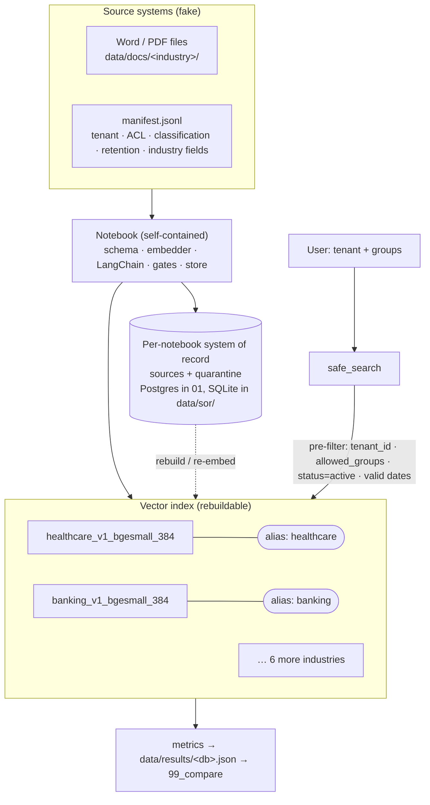
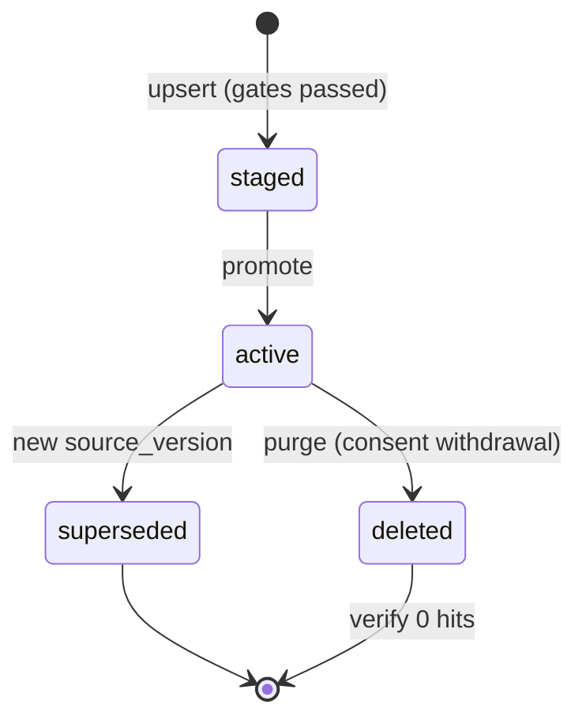

<div align="center">



# 🧠 Vector Database Schema & Ingestion Guardrails

**Industry-wise vector database schema blueprint with fail-closed ingestion.**<br>
Realistic Word/PDF documents are uploaded with **LangChain**, checked by guardrail gates, chunked, embedded and indexed into **pgvector, Qdrant, Weaviate, Milvus, Chroma and LanceDB**, with **one index per industry** and **tenant-isolated, ACL-filtered search**.

<br>


<br>


<br>


### One schema · six vector databases · eight industry indexes
**Every document gated, every query pre-filtered, every failure quarantined.**

[Quick start](#-quick-start) · [Pipeline](#-ingestion-pipeline) · [Guardrails](#-guardrails-the-gates) · [Schema](#-schema) · [DB matrix](#-the-6-database-matrix) · [Results](#-results)

</div>

---

## What & why

Most RAG demos load a PDF, embed it and search it. Real systems also have to answer harder questions:
*Who is allowed to see this chunk? Which tenant owns it? Is it still valid? What happens when the source changes or a patient withdraws consent? What stops a leaked password or an SSN from being embedded?*

This repo implements the **Vector Database Schema & Ingestion Guardrails** blueprint by hand, in Python, and runs the *same* pipeline against **6 vector databases**, with **one index per industry** in each (6 × 8 = **48 indexes**):

- **Realistic fake Word/PDF documents** for 8 industries, loaded with **LangChain** (`PyPDFLoader`, `Docx2txtLoader`).
- **Fail-closed ingestion gates**: authorized source, approved purpose, classification, ACL, retention, sensitive-data scan. Bad documents go to **quarantine**; nothing is dropped silently.
- **One Pydantic schema** (base record + typed industry fields) is the only schema source. DDL, collection configs and JSON Schema are all derived from it.
- **Tenant + ACL + status + validity pre-filtering inside the DB query**, never in Python after top-k.
- **Lifecycle**: staged → promote → active, supersede on update, hard purge + verify absence, blue/green model change via versioned index + alias.
- **Same tests in every notebook** (idempotency, isolation, update, purge, metrics), so the databases can be compared directly.

> [!NOTE]
> Everything runs locally on **Windows 11 + Podman + uv**. All sample data is invented: no real people, IDs, PHI or account numbers.

<table>
<tr>
<td width="33%" valign="top">

**🛡️ Fail-closed gates**<br>
Source, purpose, classification, ACL, retention and a secrets / SSN / card scan. Bad docs go to quarantine, never silently dropped.

</td>
<td width="33%" valign="top">

**🧬 One schema, typed per industry**<br>
A Pydantic v2 base record (identity, provenance, content, access, lifecycle) plus typed fields per industry. DDL and configs are derived from it.

</td>
<td width="33%" valign="top">

**🔐 Tenant-isolated search**<br>
Tenant + ACL + status + validity are pre-filtered **inside** the DB query. RLS, native multi-tenancy, partition keys or filters, depending on the DB.

</td>
</tr>
<tr>
<td valign="top">

**♻️ Real lifecycle**<br>
Staged → promote, supersede on update, hard purge + verify absence, blue/green model change via versioned index + alias.

</td>
<td valign="top">

**🔁 Deterministic & idempotent**<br>
`chunk_id = sha256(tenant|source|version|chunk_no)`, embedding cache by content hash: re-running a batch changes nothing.

</td>
<td valign="top">

**📊 Comparable by design**<br>
Same 14 sections and the same asserts in every notebook, metrics to `data/results/<db>.json` for the comparison notebook.

</td>
</tr>
</table>

## Table of contents

- [What \& why](#what--why)
- [🔄 Ingestion pipeline](#-ingestion-pipeline)
- [🛡️ Guardrails (the gates)](#-guardrails-the-gates)
- [🧬 Schema](#-schema)
- [🏭 Industries](#-industries)
- [🗄️ The 6-database matrix](#-the-6-database-matrix)
- [🏗️ Architecture](#-architecture)
- [📁 Repo layout](#-repo-layout)
- [🚀 Quick start](#-quick-start)
- [📓 Running the notebooks](#-running-the-notebooks)
- [📡 Live tracker](#-live-tracker)
- [🧪 Sample data](#-sample-data)
- [♻️ Lifecycle: update, delete, model change](#-lifecycle-update-delete-model-change)
- [🔐 Security notes](#-security-notes)
- [📊 Results](#-results)
- [📚 Further reading](#-further-reading)

---

## 🔄 Ingestion pipeline

<div align="center">

</div>

Each notebook runs the same 14 sections:

| # | Section | What it proves |
|---|---|---|
| 0 | Setup | uv `.venv` kernel, DB connection, versions |
| 1 | Schema | base record + 8 industry models (Pydantic = single source of truth) |
| 2 | Embedding model | pinned `BAAI/bge-small-en-v1.5`, 384d, normalized, **cached by content hash** |
| 3 | Load Word/PDF | LangChain loaders + metadata merged from `manifest.jsonl`; no manifest entry = rejected |
| 4 | Ingestion gates | source → purpose → classification → ACL → retention → sensitive scan → section chunking → validate |
| 5 | Store | one index per industry, generated from the schema, + tenant isolation + alias |
| 6 | Upload | all industries; bad docs land in quarantine |
| 7 | Idempotency | same upload again → identical row counts (deterministic IDs) |
| 8 | Staging → promote | staged chunks are never searchable |
| 9 | Safe search | golden queries per industry and tenant → hit@1, hit@5, p50 latency |
| 10 | Isolation | cross-tenant leak test, no-ACL-group test, fail-closed on missing tenant/groups |
| 11 | Update | new source version supersedes the old one |
| 12 | Delete | purge a source (consent withdrawal) and verify it is gone |

```mermaid
flowchart LR
    A[Word / PDF<br/>+ manifest.jsonl] --> B[LangChain<br/>PyPDFLoader / Docx2txtLoader]
    B --> C[Clean<br/>headers, footers, banners]
    C --> G{Gates}
    G -- fail --> Q[(Quarantine)]
    G -- pass --> R[Redact<br/>email, phone]
    R --> K[Section-aware<br/>chunking]
    K --> E[Embed<br/>bge-small 384d<br/>cache by hash]
    E --> V{Pydantic<br/>validation}
    V -- fail --> Q
    V -- pass --> S[Upsert<br/>status = staged]
    S --> P[Promote<br/>status = active]
    P --> X[safe_search<br/>tenant + ACL + status + validity<br/>pre-filter in the DB]

    classDef ingest fill:#0f2a3a,stroke:#2dd4bf,color:#e2e8f0
    classDef guard fill:#2b2410,stroke:#fbbf24,color:#fef3c7
    classDef index fill:#0c2440,stroke:#38bdf8,color:#e0f2fe
    classDef serve fill:#1f1a3a,stroke:#a78bfa,color:#ede9fe
    classDef bad fill:#2a1218,stroke:#f87171,color:#fecaca
    class A,B,C ingest
    class G,R,V guard
    class K,E index
    class S,P,X serve
    class Q bad
```

| 13 | Metrics | writes `data/results/<db>.json` for the comparison notebook |



## 🚦 Guardrails (the gates)

Each gate returns a record **or** a `Rejection(industry, source_id, gate, reason)`. Rejections are written to the `quarantine` table and shown in the notebook. The pipeline **fails closed**: missing metadata is treated as "not allowed".

| Order | Gate | Rejects when… | Example quarantined doc |
|---|---|---|---|
| 0 | Manifest | the file has no metadata entry (no metadata = no ACL) | – |
| 1 | `authorized_source` | `source_system` is not in the approved list (`ehr_export`, `core_banking`, `claims_system`, `dms_legal`, `pim`, `plm`, `records_mgmt`, `lms_hris`) | `in-bad`: `source_system 'personal_laptop' not approved` |
| 2 | `approved_purpose` | `purpose` is not `rag_search` or `support_assistant` | – |
| 3 | `classified` | `classification` is missing | – |
| 4 | `acl` | `allowed_groups` is empty | `ed-bad`: `no allowed_groups (ACL)` |
| 5 | `retention` | `retention_until` is already in the past | `gv-bad`: `retention_until 2020-12-31 already passed` |
| 6 | `sensitive_scan` | a **secret** (AWS key, private key, `password=`/`api_key=`), an **SSN**, or a **Luhn-valid card number** is found | `bk-bad` secret · `hc-bad` SSN · `rt-bad` card |
| 6b | redaction | emails → `[EMAIL]`, phone numbers → `[PHONE]` (redacted, not rejected) | `hc-001.pdf` contact line |
| 7 | `schema_validation` | the Pydantic model rejects the record (types, patterns, cross-field rules) | `lg-bad`: privileged but not `restricted` · `mf-bad`: `approval_status` not `approved` |

> [!IMPORTANT]
> Every industry ships **1 deliberately bad document**. In every finished notebook **8/8 bad documents are quarantined** and **0** reach an index.

<details>
<summary><b>Chunking and embedding details</b></summary>

- Section-aware: the document's numbered headings (`1. Purpose`, `2. Scope`, `3. Details`, …, `Revision History`) split the text first; the text before the first heading becomes `Document control`.
- Then LangChain `RecursiveCharacterTextSplitter(chunk_size=400, chunk_overlap=40)` splits each section.
- Each chunk is prefixed with `"{title} - {section}: "` so it stays meaningful on its own.
- Embedding model `BAAI/bge-small-en-v1.5` (384 dimensions, normalized). Queries get the BGE query instruction prefix.
- The embedding cache is keyed by `content_hash`, so re-running an unchanged batch embeds nothing.

</details>

## 🧬 Schema

**One record = one retrievable chunk.** The base model uses `extra="forbid"`, so unknown fields are rejected.

| Group | Fields | Guardrails in the model |
|---|---|---|
| **Identity** | `chunk_id`, `tenant_id`, `industry`, `entity_type` | `chunk_id` must equal `sha256(tenant_id\|source_id\|source_version\|chunk_no)` |
| **Provenance** | `source_id`, `source_version`, `source_file`, `chunk_no`, `section`, `content_hash`, `parent_id` | `content_hash` must match `sha256(text)`; `parent_id` ready for small-to-big retrieval |
| **Content / vector** | `text`, `embedding`, `embedding_model`, `language` | non-empty text; embedding non-empty and all finite |
| **Access / context** | `classification`, `allowed_groups`, `jurisdiction`, `valid_from`, `valid_to` | `classification ∈ {public, internal, confidential, restricted}`; at least one group; `valid_to ≥ valid_from` |
| **Lifecycle** | `retention_until`, `status`, `created_at` | retention not passed; `status ∈ {staged, active, superseded, deleted}` |

<details open>
<summary><b>Industry fields (exact names from the notebook schema cell)</b></summary>

| Industry | Model | Industry fields | Extra rules |
|---|---|---|---|
| healthcare | `HealthcareChunk` | `patient_ref_token`, `record_type`, `provider`, `encounter_date`, `consent_scope` | token pattern `^tok_[a-z0-9]+$`; `consent_scope ∈ {treatment, care_coordination, research}` |
| banking | `BankingChunk` | `customer_ref_token`, `product`, `account_type`, `document_type`, `effective_date` | optional tokenized customer ref |
| insurance | `InsuranceChunk` | `policy_ref`, `claim_ref`, `line_of_business`, `event_date`, `claim_status` | `claim_status ∈ {open, closed, n/a}` |
| legal | `LegalChunk` | `matter_id`, `client_ref`, `privilege_status`, `document_type`, `effective_date` | privileged / work-product **must** be `restricted` |
| retail | `RetailChunk` | `product_id`, `sku`, `brand`, `locale`, `channel`, `price_valid_from`, `price_valid_to`, `inventory_region` | `channel ∈ {online, store, omni}` |
| manufacturing | `ManufacturingChunk` | `asset_id`, `site_id`, `equipment_type`, `safety_class`, `revision`, `document_owner`, `approval_status` | only `approved` procedures are indexed |
| government | `GovernmentChunk` | `agency_id`, `record_class`, `release_status`, `case_ref_token` | `public` classification requires `public_release` |
| education_hr | `EducationHrChunk` | `domain`, `org_unit`, `course_or_department`, `term`, `region`, `subject_ref_token` | `domain ∈ {education, hr}` |

No raw identifiers ever reach vector metadata: people and cases are referenced by **tokens** (`tok_…`).

</details>

## 🏭 Industries

| Industry | Index (versioned) | Alias | Tenants (fake) | Approved source system | Files |
|---|---|---|---|---|---|
| 🩺 healthcare | `healthcare_v1_bgesmall_384` | `healthcare` | `acme_health`, `beacon_clinic` | `ehr_export` | 5 (3 PDF, 2 DOCX) |
| 🏦 banking | `banking_v1_bgesmall_384` | `banking` | `northbank`, `river_cu` | `core_banking` | 5 |
| 🛡️ insurance | `insurance_v1_bgesmall_384` | `insurance` | `shieldco`, `harbor_mutual` | `claims_system` | 5 |
| ⚖️ legal | `legal_v1_bgesmall_384` | `legal` | `lexpartners`, `cityattorneys` | `dms_legal` | 5 |
| 🛍️ retail | `retail_v1_bgesmall_384` | `retail` | `shopnova`, `urbanmart` | `pim` | 5 |
| ⚙️ manufacturing | `manufacturing_v1_bgesmall_384` | `manufacturing` | `forgeworks`, `voltgrid` | `plm` | 5 |
| 🏛️ government | `government_v1_bgesmall_384` | `government` | `state_dmv`, `city_planning` | `records_mgmt` | 5 |
| 🎓 education_hr | `education_hr_v1_bgesmall_384` | `education_hr` | `northstate_univ`, `globex_corp` | `lms_hris` | 5 |

Per industry: 4 good documents over 2 tenants → **28 chunks**, plus 1 bad document → quarantine.

## 📊 The 6-database matrix

<div align="center">

</div>

| | **pgvector** | **Qdrant** | **Weaviate** | **Milvus** | **Chroma** | **LanceDB** |
|---|---|---|---|---|---|---|
| **Runs as** | server (Podman `pgvector/pgvector:pg17`) | server (Podman) | server (Podman) | server (Podman: milvus + etcd + minio) | **embedded** (`data/chroma`) | **embedded** (`data/lancedb`) |
| **Industry index** | table `{industry}_v1_bgesmall_384` | collection | collection | collection | collection | table (PyArrow schema) |
| **Vector index** | HNSW `vector_cosine_ops` | HNSW | HNSW | HNSW | HNSW | flat (vector index after ~10k rows) |
| **Tenant isolation** | **Row-Level Security** on `app.tenant_id`, non-superuser app role | `tenant_id` payload index with `is_tenant=true` + filter | **native multi-tenancy** (one shard per tenant) | `tenant_id` **partition key** + filter | `where` filter only ⚠️ | `where` pre-filter only ⚠️ |
| **ACL filter** | `allowed_groups && :groups` + GIN | `MatchAny` on keyword index | `ContainsAny` on `text[]` | `ARRAY_CONTAINS_ANY` | `$contains` on groups | `array_has_any(allowed_groups, …)` |
| **Alias / blue-green** | view `{industry}` | collection alias | collection alias | collection alias | name mapping | name mapping |
| **Enforced by the DB?** | ✅ yes (RLS) | filter in query | ✅ tenant shard | filter + partition | ❌ app-side filter | ❌ app-side filter |

> [!WARNING]
> Chroma and LanceDB are embedded libraries with no auth, RLS or native tenancy. Their isolation tests pass because `safe_search` always pre-filters, but the **database does not enforce it**. They are flagged as *filter-only* in the comparison, not claimed as equivalent.

## 🧭 Architecture



Design patterns applied (full list in [docs/PLAN.md](docs/PLAN.md)):

| Pattern | Applied as |
|---|---|
| Index, not source of truth | Every vector index can be rebuilt from the system of record (`sources`) |
| Deterministic ID + idempotent upsert | `chunk_id = sha256(tenant\|source\|version\|chunk_no)` |
| Index per industry, tenant inside it | separate index per industry; tenant = RLS / shard / partition / filter |
| Pre-filter in the vector query | tenant + ACL + status + validity inside the ANN query |
| Same store contract everywhere | `create_indexes`, `upsert`, `promote`, `safe_search`, `supersede`, `purge` |
| Fail-closed gate pipeline | every gate returns a record or a `Rejection` → quarantine |
| Versioned index + alias | `{industry}_v{schema}_{model}_{dim}` + alias `{industry}` |
| Status lifecycle | `staged → active → superseded / deleted`; search reads only `active` |
| Hard purge + verify absence | delete by `source_id`, assert 0 hits |
| Embedding cache | keyed by `content_hash` |

## 📁 Repo layout

```text
VectorDB-Schema/
├── README.md                  ← you are here
├── AGENTS.md                  ← rules for AI coding agents (agents.md format)
├── SETUP.md                   ← step-by-step environment setup, one section per DB
├── pyproject.toml / uv.lock   ← uv project, one optional extra per DB
├── compose.yaml               ← Podman compose profiles: pg, qdrant, weaviate
├── docker/milvus/             ← Milvus standalone compose (milvus + etcd + minio)
├── sql/                       ← mounted into the pg container as init scripts
├── docs/
│   ├── PLAN.md                ← the reference design
│   └── assets/                ← animated SVG infographics used in this README
├── data/
│   ├── docs/<industry>/       ← fake Word/PDF files + manifest.jsonl
│   ├── samples/               ← fake source text <industry>.jsonl + golden_queries.json
│   ├── results/<db>.json      ← metrics written by each notebook (gitignored)
│   ├── sor/                   ← per-notebook SQLite system of record (gitignored)
│   └── chroma/  lancedb/      ← embedded DB files (gitignored)
├── notebooks/
│   ├── 01_pgvector.ipynb      ← reference notebook
│   ├── 02_qdrant.ipynb
│   ├── 03_weaviate.ipynb
│   ├── 04_milvus.ipynb
│   ├── 05_chroma.ipynb
│   ├── 06_lancedb.ipynb
│   └── 99_compare.ipynb       ← cross-DB comparison
└── scripts/
    ├── setup.ps1              ← one-shot setup (Windows + Podman)
    ├── track.ps1              ← live notebook progress tracker
    ├── make_samples.py        ← generates fake sample text + golden queries
    └── make_docs.py           ← turns samples into realistic Word/PDF files
```

There is **no `src/` package**: each notebook is self-contained (schema, embedder, loaders, gates, store), so every DB can be read top to bottom on its own.

## 🚀 Quick start

**Prerequisites:** Windows 11, [uv](https://docs.astral.sh/uv/), [Podman](https://podman.io/) (with a Podman machine), Git. Python 3.14 is installed by uv from `.python-version`.

### Fast path

```powershell
git clone https://github.com/ashishpatel26/VectorDB-Schema.git VectorDB-Schema
cd VectorDB-Schema
powershell -ExecutionPolicy Bypass -File scripts\setup.ps1                 # everything
powershell -ExecutionPolicy Bypass -File scripts\setup.ps1 -SkipMilvus     # without Milvus + Attu
powershell -ExecutionPolicy Bypass -File scripts\setup.ps1 -SkipContainers # Python side only
powershell -ExecutionPolicy Bypass -File scripts\setup.ps1 -SetWslMemory   # + raise WSL memory to 8 GB (restarts ALL WSL distros)
```

The script is safe to re-run. It installs the Python extras per DB, registers the Jupyter kernel, downloads the embedding model, creates `.env` / folders without overwriting anything, starts and health-checks pgvector, Qdrant and Weaviate (and Milvus + Attu), and verifies that Chroma and LanceDB import.

> [!TIP]
> **Docker Hub rate limits:** Weaviate and Milvus pull several images. If a pull fails with `toomanyrequests`, log in once and re-run:
> ```powershell
> podman login docker.io
> ```

### Manual path

Follow [SETUP.md](SETUP.md): 13 steps, each with **Do** and **Expect**, plus a smoke test per database. In short:

```powershell
uv sync --all-extras
podman compose --profile pg --profile qdrant --profile weaviate up -d   # server DBs
podman compose -f docker/milvus/docker-compose.yml up -d                # Milvus (heaviest, only when needed)
# Chroma and LanceDB are embedded: nothing to start
```

> [!NOTE]
> Always use full image names (`docker.io/...`, `cr.weaviate.io/...`) with Podman; short names can make it prompt for a registry.

## 📓 Running the notebooks

Open any notebook in VS Code or Jupyter and choose the kernel **`VectorDB Schema (uv .venv)`** (kernel name `vectordb-schema`). Run them in order: `01_pgvector` is the reference; `99_compare` reads every `data/results/<db>.json`.

Headless (exactly what the assert cells are checked with):

```powershell
cd notebooks
uv run jupyter nbconvert --to notebook --execute --inplace `
    --ExecutePreprocessor.kernel_name=vectordb-schema 01_pgvector.ipynb
```

A notebook is **done** when every cell has run with **0 error outputs**: the idempotency, isolation, update and purge cells contain `assert`s.

| Notebook | DB | Needs |
|---|---|---|
| [01_pgvector](notebooks/01_pgvector.ipynb) | pgvector | `podman compose --profile pg up -d` |
| [02_qdrant](notebooks/02_qdrant.ipynb) | Qdrant | `--profile qdrant` |
| [03_weaviate](notebooks/03_weaviate.ipynb) | Weaviate | `--profile weaviate` |
| [04_milvus](notebooks/04_milvus.ipynb) | Milvus | `docker/milvus/docker-compose.yml` (give WSL ≥ 8 GB) |
| [05_chroma](notebooks/05_chroma.ipynb) | Chroma | nothing (embedded) |
| [06_lancedb](notebooks/06_lancedb.ipynb) | LanceDB | nothing (embedded) |
| 99_compare | all | the `data/results/*.json` files |

## 📡 Live tracker

Watch all notebooks being built and executed, with hit@1 and p50 latency as soon as a metrics file appears:

```powershell
powershell -ExecutionPolicy Bypass -File scripts\track.ps1            # refresh every 5 s, Ctrl+C to stop
powershell -ExecutionPolicy Bypass -File scripts\track.ps1 -Once      # print once
powershell -ExecutionPolicy Bypass -File scripts\track.ps1 -Seconds 2
```

It shows, per notebook: built, sections (`n/14`), executed cells, error outputs, hit@1, p50 ms, last update, status (`waiting`, `built, not run yet`, `partially run`, `ERRORS`, `DONE`), plus the running Podman containers.

## 🧪 Sample data

All content is **fake**. Each industry has 5 controlled-looking business documents: letterhead, classification banner, document-control table, numbered sections (Purpose, Scope, Details, Responsibilities, References), revision history, approval block and page footer. Odd-numbered documents are PDF, even-numbered are Word.

- `data/samples/<industry>.jsonl`: source text and planned metadata (4 good docs over 2 tenants + 1 bad doc).
- `data/samples/golden_queries.json`: 2 golden queries per industry (one per tenant) with the expected source.
- `data/docs/<industry>/*.pdf|*.docx` + `manifest.jsonl`: the files the notebooks load. The manifest plays the role of the source system's metadata export.

Regenerate everything:

```powershell
uv run python scripts/make_samples.py
cd scripts; uv run python make_docs.py
```

## 🔄 Lifecycle: update, delete, model change



| Operation | How | Verified by |
|---|---|---|
| **Update** | load the new version → ingest as `source_version=2` → `supersede(old)` marks v1 `superseded` | search returns only v2 chunks (e.g. `hc-002`: 7 superseded, 7 active) |
| **Delete / consent withdrawal** | `purge(source_id)` hard-deletes chunks **and** the system-of-record rows | `safe_search` before → `['hc-004']`, after → `[]`, `sources` rows left: 0 |
| **Embedding model change** | never re-embed in place: build `{industry}_v1_<newmodel>_<dim>`, re-embed from the system of record, run the golden queries, switch the alias, drop the old index | golden queries on the new index before the alias switch |

## 🔐 Security notes

- **Fake data only.** No real names, IDs, PHI, card or account numbers anywhere in `data/`.
- **No raw identifiers in vector metadata**: tokens such as `patient_ref_token`, `customer_ref_token`.
- **`.env` is never committed**, nor DB data folders (`data/chroma/`, `data/lancedb/`, `data/sor/`), results or container volumes.
- **Postgres RLS uses a non-superuser app role** (`vdb_app`), because superusers bypass RLS. With no `app.tenant_id` set, the app role sees **0 rows**.
- `safe_search` **raises** if the tenant or groups are missing (fail closed).
- Container credentials (`dev`) are for local use only.

## 📊 Results

<!-- RESULTS:START -->
Golden queries: 2 per industry (one per tenant) × 8 industries = 16 queries per DB. 224 active chunks per DB (28 per industry), 8/8 bad documents quarantined.

| DB | Status | hit@1 | hit@5 | p50 latency | Quarantined | Tenant isolation |
|---|---|---|---|---|---|---|
| **pgvector** | ✅ done | 1.00 | 1.00 | 4.2 ms | 8/8 | ✅ PASS · Row-Level Security + ACL pre-filter |
| **Qdrant** | ✅ done | 1.00 | 1.00 | 7.9 ms | 8/8 | ✅ PASS · `is_tenant` payload index + mandatory filter (no server-side RLS) |
| **Weaviate** | ⏸️ not run (Docker Hub rate limit: `podman login docker.io`) | – | – | – | – | native multi-tenancy (shard per tenant) + ACL pre-filter |
| **Milvus** | ✅ done | 1.00 | 1.00 | 6.0 ms | 8/8 | ✅ PASS · partition key + tenant/ACL pre-filter |
| **Chroma** | ✅ done | 1.00 | 1.00 | 6.9 ms | 8/8 | ✅ PASS · ⚠️ filter-only (embedded, no server-side enforcement) |
| **LanceDB** | ✅ done | 1.00 | 1.00 | 15.2 ms | 8/8 | ✅ PASS · ⚠️ filter-only (embedded, prefilter) |

Latency is local, single-user, on a Windows laptop with ~28 chunks per index: use it to compare, not as a benchmark. Source: `data/results/<db>.json` written by each notebook.
<!-- RESULTS:END -->

## 📚 Further reading

- [docs/PLAN.md](docs/PLAN.md): the full design, patterns and per-DB mapping
- [SETUP.md](SETUP.md): environment setup with a smoke test per database
- [AGENTS.md](AGENTS.md): rules for AI agents and contributors (design rules that must not break)
- [notebooks/01_pgvector.ipynb](notebooks/01_pgvector.ipynb): the reference implementation
